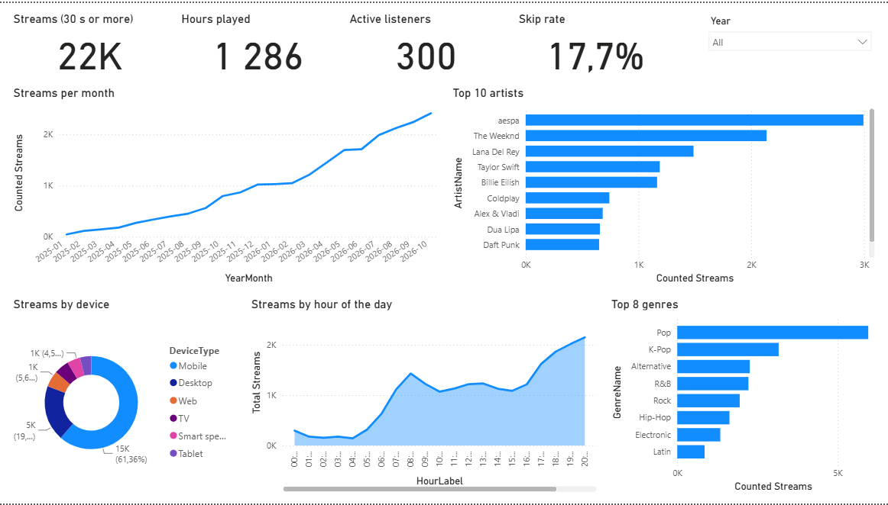
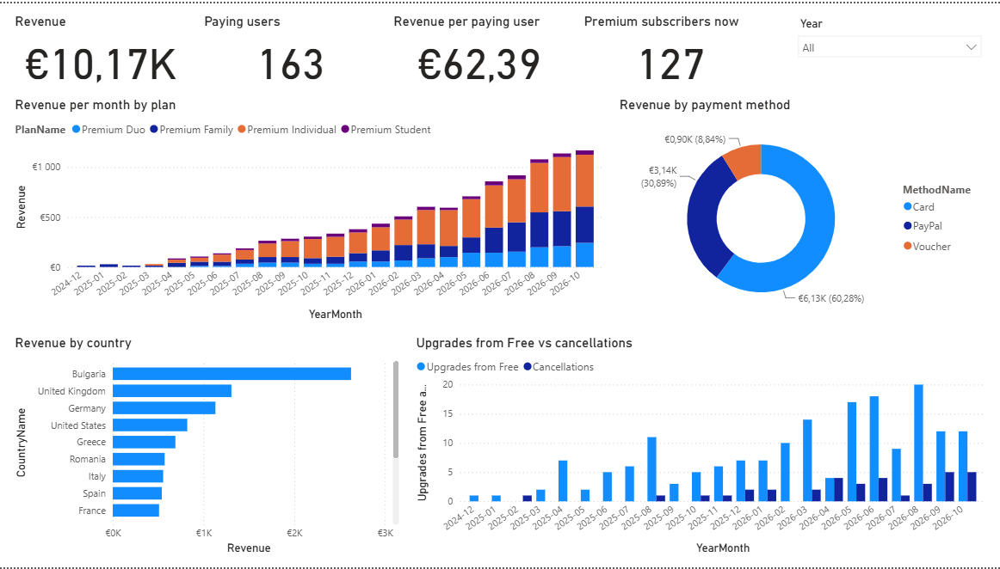

# Spotify – платформа за стрийминг на музика

*   **Студент:** Наим Абаз
*   **Факултетен номер:** 2401321010
*   **Проект:** Spotify
*   **Бизнес изисквания:** [course-work/project-template.md](../../project-template.md)

## Описание

Проектът моделира онлайн платформа за стрийминг на музика по модела на Spotify. Базата данни пази каталог
от изпълнители, албуми и песни, потребители с абонаменти и плащания, плейлисти, харесани песни, последвани
изпълнители и потребители, както и всяко слушане (дата и час, устройство, държава, изслушани секунди,
прескачане). Върху нея е изграден склад от данни (звездна схема) и доклад в Power BI, който следи слушанията,
приходите и абонаментите.

| Част | Съдържание |
| :--- | :--- |
| Концептуален модел (Chen) | 12 същности, 17 връзки, 75 атрибута |
| Логически модел (Crow's Foot) | 18 таблици, 98 атрибута, 6 връзки много към много |
| База данни `SpotifyDB` (MS SQL Server) | 18 таблици, 4 функции, 3 изгледа, 4 тригера, 7 съхранени процедури |
| Данни | 128 изпълнители, 143 албума, 410 песни, 300 потребители, 539 абонамента, 1 165 плащания, 25 013 слушания |
| Склад от данни `SpotifyDW` (UML) | 3 таблици факти, 10 таблици измерения, ETL процедура |
| Доклад в Power BI | 2 страници, 19 визуализации, 13 DAX мерки |

## Структура на папката

```
diagrams/                 концептуален (Chen), логически (Crow's Foot) и DWH (UML) модел – .drawio + .png
database/
  01_create_database.sql  създава SpotifyDB: таблици, ключове, ограничения, индекси
  02_programmability.sql  функции, изгледи, тригери, съхранени процедури
  03_seed_data.sql        данни (генериран файл)
  04_demo_queries.sql     демонстрация на процедурите, функциите и тригерите
data-warehouse/
  01_create_dw.sql        създава SpotifyDW: таблици факти и измерения
  02_load_dw.sql          ETL процедура dbo.usp_LoadWarehouse (SpotifyDB -> SpotifyDW)
  03_analytics_queries.sql справките от бизнес изискванията върху склада
power-bi/
  Spotify.pbip            Power BI проект (отваря се с Power BI Desktop)
  screenshots/            изглед на двете страници на доклада
tools/gen_seed_data.py   Python скрипт, който генерира database/03_seed_data.sql
```

## Изисквания

*   Microsoft SQL Server 2019 или по-нов (тестван с SQL Server 2022 Developer) и `sqlcmd` или SSMS
*   Power BI Desktop (тестван с версия 2.159, ноември 2026)
*   draw.io (app.diagrams.net или desktop) – за отваряне на диаграмите
*   По желание: Python 3.10+ – само ако искате да генерирате данните наново

## Инсталация и стартиране

### 1. База данни

Скриптовете се изпълняват по ред. Всеки от двата create скрипта изтрива и създава базата наново.

```bash
sqlcmd -S localhost -E -C -i database/01_create_database.sql
sqlcmd -S localhost -E -C -i database/02_programmability.sql
sqlcmd -S localhost -E -C -i database/03_seed_data.sql
```

В SSMS: отворете файловете един по един и натиснете **Execute**. Зареждането на данните отнема около 40 секунди.

Демонстрация на процедурите, функциите и тригерите (не променя данните – всичко, което създава, го изтрива):

```bash
sqlcmd -S localhost -E -C -i database/04_demo_queries.sql
```

### 2. Склад от данни

```bash
sqlcmd -S localhost -E -C -i data-warehouse/01_create_dw.sql
sqlcmd -S localhost -E -C -i data-warehouse/02_load_dw.sql
sqlcmd -S localhost -E -C -i data-warehouse/03_analytics_queries.sql
```

След промяна на данните в `SpotifyDB` складът се презарежда с `EXEC SpotifyDW.dbo.usp_LoadWarehouse;`.

### 3. Доклад в Power BI

1.  Отворете `power-bi/Spotify.pbip` с Power BI Desktop.
2.  Натиснете **Home → Refresh**. Данните се зареждат от `localhost`, база `SpotifyDW`
    (при първо свързване изберете Windows удостоверяване).
3.  Ако SQL Server е с друго име, сменете го от **Transform data → Data source settings**.




## База данни – програмируеми обекти

| Тип | Име | Какво прави |
| :--- | :--- | :--- |
| Функция | `fn_UserAge` | възраст на потребител към дата |
| Функция | `fn_UserPlanAt` | план на потребител към дата |
| Функция | `fn_UserSkipsInLastHour` | брой прескачания през последния час |
| Функция (таблична) | `fn_TopTracks` | най-слушаните песни за период (слушане ≥ 30 сек.) |
| Тригер | `trg_Users_AssignFreePlan` | при регистрация потребителят получава план Free |
| Тригер | `trg_Subscriptions_StudentPlan` | Premium Student само при потвърден студентски статус |
| Тригер | `trg_Streams_AfterInsert` | проверява продължителността и нецензурното съдържание (< 18 г.), обновява `PlayCount` |
| Тригер | `trg_ArtistFollowers_Count` | поддържа `FollowersCount` на изпълнителя |
| Процедура | `usp_RegisterUser` | регистрация с проверка за възраст ≥ 13 и уникален имейл |
| Процедура | `usp_ChangeSubscriptionPlan` | смяна на план + плащане |
| Процедура | `usp_CancelSubscription` | отказ – Premium остава до края на платения период |
| Процедура | `usp_ProcessRenewal` | месечно подновяване; при неуспешно плащане – обратно към Free |
| Процедура | `usp_AddTrackToPlaylist` | добавяне на песен (само собственикът, без дублиране, до 10 000 песни) |
| Процедура | `usp_RecordStream` | записва слушане; Free план – до 6 прескачания на час |
| Процедура | `usp_RefreshArtistStats` | преизчислява месечните слушатели и последователите |

## Склад от данни

*   **Факти:** `FactStreams` (едно слушане), `FactPayments` (едно плащане), `FactSubscriptions` (един абонаментен период)
*   **Измерения:** `DimDate`, `DimTime`, `DimUser`, `DimLocation`, `DimTrack`, `DimArtist`, `DimGenre`, `DimDevice`,
    `DimPlan`, `DimPaymentMethod`
*   `DimDate` се използва два пъти от `FactSubscriptions` – начална и крайна дата (role-playing dimension).

## Допълнения извън условието

*   Втори модел-изглед на данните: 3 изгледа (`vw_TrackCatalog`, `vw_UserCurrentPlan`, `vw_MonthlyRevenue`).
*   Бизнес правилата са наложени в самата база: CHECK ограничения, филтрирани уникални индекси
    (един активен абонамент на потребител, един основен изпълнител и един основен жанр на песен),
    каскадно изтриване на плейлисти, индекси върху външните ключове.
*   Скрипт `04_demo_queries.sql`, който показва всяка процедура, функция и тригер, включително очакваните грешки.
*   ETL процедура за презареждане на склада и SQL справки за всички показатели от бизнес изискванията.
*   Реален музикален каталог (128 изпълнители); потребителите, абонаментите и слушанията са симулирани,
    но следват бизнес правилата.
*   Данните се генерират от скрипта `tools/gen_seed_data.py` (с фиксиран seed), така че са възпроизводими.
